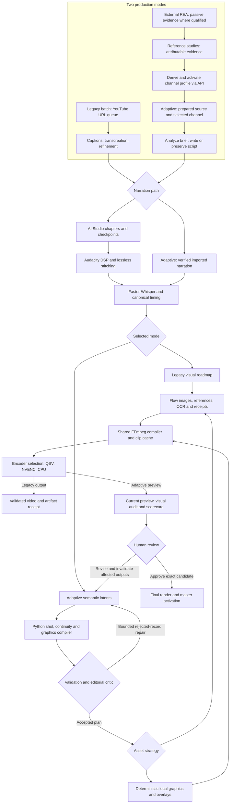

# Autonomous YouTube Video Production Pipeline


[](https://github.com/Snoozer10/local-youtube-automation/actions/workflows/ci.yml)
[](https://www.python.org/)
[](https://github.com/Snoozer10/local-youtube-automation)
[](LICENSE)

[](https://playwright.dev/)
[](https://github.com/SYSTRAN/faster-whisper)
[](https://www.audacityteam.org/)
[](https://ffmpeg.org/)
[](https://labs.google/fx/tools/flow)
[](https://gemini.google.com/app)
[](https://telegram.org/)

An autonomous multimedia production pipeline that turns source material into complete YouTube videos: conversational script transcreation, expressive narration, audio mastering, word-aligned subtitles, continuity-aware visuals, thumbnails, and hardware-accelerated video assembly. Channel profiles shape the language, audience, voice, and visual identity across different niches and content formats.

Two production modes serve different ways of working. **Legacy batch mode** takes a queue of YouTube URLs through transcript extraction, script preparation, and eligible production stages. **Adaptive staged mode** starts from an explicit channel and prepared source, analyzes the episode, writes or preserves its script, and coordinates narration, semantic visual planning, generation, review, and final rendering through separate resumable stages.

The goal is broadcast-quality, high-retention video production with automation for repetitive work and direct editorial control over the result. Browser-driven Gemini, AI Studio, and Flow stages use signed-in web sessions without model API keys. Service access, subscriptions, quotas, optional integration credentials, and local computing costs still apply.

## Choose your path

- **New to coding?** Use the [AI setup prompt](#copy-and-paste-to-your-ai-agent). Your agent installs applicable dependencies and teaches you how to use your own setup.
- **Installing manually?** Follow [Getting started](docs/getting-started.md).
- **Producing with adaptive mode?** Follow the [complete adaptive mode guide](docs/usage/adaptive-mode.md).
- **Creating your own channel?** Follow [Channel bundles](docs/usage/channel-bundles.md), or begin with [reference-channel research and REA](docs/usage/channel-research.md).

## Features and algorithms

| Capability | What it does |
|---|---|
| Two production modes | Run a legacy URL batch or control adaptive production one explicit stage at a time. |
| Channel bundles | Keep audience, language, voice, visual policy, and forbidden motifs separate from the subject of each episode. |
| Channel research and REA evidence | Preserve attributable reference evidence, check study readiness, derive a production profile, and activate a versioned revision through local APIs. The research guide explains the separate external REA collector's role and current integration limits. |
| Script transcreation and refinement | Adapt source material into channel-specific spoken narration, with configurable language, tone, pronunciation, and refinement prompts. |
| Narration and audio engineering | Generate chapter-based AI Studio speech, process audio through Audacity's Windows named pipes, and stitch compatible chapters losslessly. Supported episodes can import existing narration. |
| Speech-aligned timing | Use Faster-Whisper and transcript reconciliation to build the canonical timing used by subtitles and visual planning. |
| Semantic visual planning | Ask Gemini for scene meaning and narration-linked intent; Python compiles exact shot timing, continuity, local graphics, and coverage constraints. A separate critic reviews the plan before image generation. |
| Targeted repairs | Retain planning checkpoints and correct rejected records within bounded repair transactions. Transport failure, schema failure, semantic rejection, and quota exhaustion follow different recovery paths. |
| Continuity and local graphics | Reference earlier assets and character identities where supported; render exact text, diagrams, timers, and counters locally instead of asking an image model to invent them. |
| Asset acceptance | Check generated assets for required dimensions, text/OCR rules, reference identity, and content-bound receipts before downstream use. |
| Rendering and fallback | Negotiate Intel QSV, NVIDIA NVENC, or CPU encoding. Hardware compilation failures can use an isolated CPU generation while preserving earlier evidence. Render recipes and clip receipts support compatible reuse. |
| Durable execution | Use checkpoints, hash-bound recipes, fenced resource leases, retry limits, and preserved failure records to resume supported work without treating stale output as current. |
| Editorial control | Bind visual audits, scorecards, approval, and rejection to the actual adaptive preview and inputs. Technical validation does not approve a video's editorial quality. |
| Operational visibility | Inspect adaptive status and redacted diagnostics; configure Telegram notifications for supported supervisor paths. |

These are mechanisms implemented in the project. Output quality, audience retention, and readiness for a particular channel still depend on the source, configuration, review, and verified service access.

## How it works

The project has **two production modes**, each with its own workflow:

| | Legacy batch mode | Adaptive staged mode |
|---|---|---|
| Start from | YouTube URLs in `youtube_urls.txt` | A prepared run and an explicitly selected channel profile |
| Main entrypoint | `run_agency.py` | `adaptive_production.py` plus the documented audio/thumbnail wrappers |
| Execution | Supervisor processes queued sources and eligible stages | You or an agent invoke individual stages with their prerequisites |
| Channel behavior | Existing legacy writing and pipeline configuration | Saved channel identity plus an episode-specific brief and visual strategy |
| Progress and recovery | Per-run batch state and stage checkpoints | Content-bound jobs, validated outputs, checkpoints, and explicit review lineage |
| Instructions | [Setup and batch launch](docs/getting-started.md#legacy-batch-mode) | [Adaptive mode usage](docs/usage/adaptive-mode.md) |



This map summarizes the architecture. Mode-specific commands, supported reference paths, retry conditions, and outputs are defined in the [adaptive guide](docs/usage/adaptive-mode.md). Study and profile management use Python APIs, not an extra `adaptive_production.py` stage. External REA is a separate evidence collector; the project's offline study proof does not establish live Windows REA collection. Shared resource ownership and cumulative allowance checks apply around live operations, and a changed input can invalidate later cached work.

## Try a bundled channel or create your own

The bundled channel profiles are **examples for trying and testing the system**:

| Example | What to explore |
|---|---|
| [Arabic explainers](channels/professor-yashrah.json) | Conversational explanation, illustrated subjects, and narration-linked local graphics |
| [Military history](channels/soldiers-ledger.json) | English narration, period-aware visual policy, and distinctions between fact and reconstruction |
| [Anime story recaps](channels/snoozer-anime.json) | Arabic character-driven recaps and continuity; no synthesis voice is selected in this example |

You can create a personal channel bundle for a different niche, audience, language, voice, and visual style. Here, a bundle means the saved profile and related configuration/assets you organize for that channel. It is not a separate plugin or package format. Follow [the channel bundle guide](docs/usage/channel-bundles.md) to create and validate one; use [the reference-channel research guide](docs/usage/channel-research.md) when you want an evidence-backed profile informed by reviewed reference observations.

The examples do not limit the project's intended niches or establish that every possible niche has been tested. A profile with no synthesis voice blocks TTS; imported narration follows its own source-audio path.

## Copy and paste to your AI agent

Copy this prompt into an agent with access to your computer's terminal:

```text
Help me install and learn https://github.com/Snoozer10/local-youtube-automation. I have no
programming experience. First read docs/agents/setup.md in my existing checkout; if none exists,
read https://github.com/Snoozer10/local-youtube-automation/blob/master/docs/agents/setup.md, then
clone into a new folder. Follow repository instructions, inspect my machine, preserve existing files
and private settings, and perform applicable setup. Explain blockers simply. Ask for my exact
allowance before live service, browser, application or pipeline work. Finish with verified/not-run
results and a short numbered tutorial using my actual paths. Stop if the guide is unavailable.
```

The [full agent setup guide](docs/agents/setup.md) supplies the installation and teaching procedure. The public usage guides cover [adaptive mode](docs/usage/adaptive-mode.md), [personal channel bundles](docs/usage/channel-bundles.md), and [reference research](docs/usage/channel-research.md).

## Requirements and configuration

The full pipeline is Windows-oriented. Package metadata declares Python 3.10 and later; current software CI uses Python 3.11. Depending on the selected stages, install FFmpeg/FFprobe, Audacity, an authenticated Chromium browser, Tesseract language data, and the Python audio/image dependencies. See [Getting started](docs/getting-started.md) for the installation sequence and expected checks.

| Configuration | Purpose |
|---|---|
| [.env.example](.env.example) | Browser/model routing, optional notifications, and integration settings; put private values in your local `.env` |
| [channels/](channels/) | Bundled channel profiles; keep personal profiles separate unless you intend to contribute them |
| [daheeh_config.json](daheeh_config.json) | Legacy writing and pronunciation configuration |
| [video_config.txt](video_config.txt) | Default video render settings; adaptive runs can use a run-local copy |
| [transcribe_config.txt](transcribe_config.txt) | Local transcription settings |

Run folders normally live under `youtube_runs/`. The [adaptive guide](docs/usage/adaptive-mode.md) explains their inputs, outputs, review artifacts, and activation pointers. Preserve accepted media and recovery state when pausing. Keep credentials and browser session data private.

## Documentation and contribution

| If you need to... | Start here |
|---|---|
| Install manually | [Getting started](docs/getting-started.md) |
| Have an AI agent install and teach | [AI-assisted setup](docs/agents/setup.md) |
| Use every adaptive stage | [Adaptive mode](docs/usage/adaptive-mode.md) |
| Create or customize a channel | [Channel bundles](docs/usage/channel-bundles.md) |
| Study reference channels and derive profiles | [Channel research and REA](docs/usage/channel-research.md) |
| Find architecture and project documentation | [Documentation map](docs/README.md) |
| Contribute changes | [Repository instructions](AGENTS.md) and [engineering routes](docs/agents/workflows.md) |

For every change, assess [documentation impact](docs/agents/readme-maintenance.md): update affected public guides or explain why no update is needed. Run `python tools/check_readme.py` for public documentation changes. Pull requests use the [project checklist](.github/PULL_REQUEST_TEMPLATE.md).

## License

This project is distributed under the [MIT License](LICENSE).
