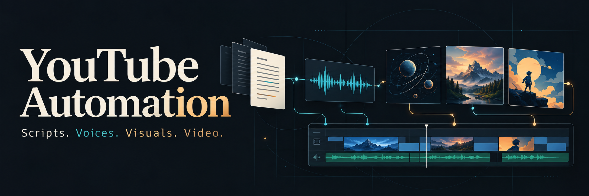
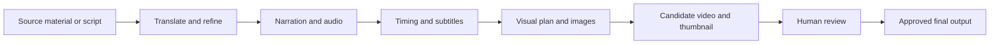

# YouTube Automation



[](https://github.com/Snoozer10/local-youtube-automation/actions/workflows/ci.yml)
[](https://www.python.org/)
[](https://github.com/Snoozer10/local-youtube-automation)
[](LICENSE)

Build a repeatable video-production workflow around your channel, language, and subject matter. This Windows-focused Python project can take source material through script preparation, narration, audio processing, visuals, subtitles, and video assembly. You choose the channel and workflow, and review the result.

The project is designed for different niches and content formats. Bundled profiles include [Arabic explainers](channels/professor-yashrah.json), [military history](channels/soldiers-ledger.json), and [anime story recaps](channels/snoozer-anime.json). These profiles and pilots demonstrate the intended variety; they do not establish that every niche has been tested.

## Choose your path

- **New to coding?** Copy the [AI setup prompt](#copy-and-paste-to-your-ai-agent) into an agent with access to your computer's terminal. It points to the full [AI setup guide](docs/agents/setup.md).
- **Want to install it yourself?** Follow [Getting started](docs/getting-started.md).
- **Want to understand the project?** Read [How it works](#how-it-works) and the [project documentation map](docs/README.md).
- **Want to produce a video?** Read the relevant workflow guide before starting a command that contacts services or creates media.

## Copy and paste to your AI agent

Copy and paste this prompt into your coding agent:

```text
Help me install and learn https://github.com/Snoozer10/local-youtube-automation. I have no
programming experience. First read docs/agents/setup.md in my existing checkout; if none exists,
read https://github.com/Snoozer10/local-youtube-automation/blob/master/docs/agents/setup.md, then
clone into a new folder. Follow repository instructions, inspect my machine, preserve existing files
and private settings, and perform applicable setup. Explain blockers simply. Ask for my exact
allowance before live service, browser, application or pipeline work. Finish with verified/not-run
results and a short numbered tutorial using my actual paths. Stop if the guide is unavailable.
```

The prompt is the short starting point. The [full guide](docs/agents/setup.md) gives the agent detailed setup, safety, and teaching instructions. Stop if the guide is unavailable.

## What the project does

YouTube Automation is a set of Python tools for preparing and producing videos. Depending on the selected workflow and installed software, it can:

- collect captions or accept a prepared script
- translate and refine narration for a selected channel
- synthesize speech and process audio
- align speech with subtitles and visual timing
- plan or generate images and assemble a video
- save progress and resume supported production steps

Some steps use browser sessions or external services. Availability, model choices, quotas, account requirements, and costs depend on your configuration and service accounts. This project does not promise free production or zero credentials.

## How it works



There are two main workflows:

1. **Legacy batch workflow.** Running the top-level batch script starts processing URLs in youtube_urls.txt and continues through eligible production stages. This is a real production run. It may contact services, use browser profiles, consume quotas, and create or update files under youtube_runs/. Do not use it to check an installation.
2. **Adaptive staged workflow.** The optional workflow selects a channel and offers separate stages for analysis, writing, planning, generation, preview, review, and rendering. Read the [adaptive usage guide](tasks/adaptive-visual-usage.md) for supported commands and gates.

Adaptive production asks you to select a saved channel profile. Profiles capture channel choices such as language, voice, and visual style; an episode can then use a topic-specific plan. Included profiles illustrate the design, and do not establish that every niche has been tested. A profile with no synthesis voice, or a run using imported source audio, cannot be treated as ordinary text-to-speech production.

Technical checks do not replace review of the video itself. Adaptive production requires review of the current preview before approval and rendering. A revised or rejected preview needs fresh review.

## Getting started

Follow [docs/getting-started.md](docs/getting-started.md) for the manual setup path, including prerequisites, a Python environment, dependencies, private configuration, and a safe installation check.

Package metadata declares Python 3.10 and later. The current CI workflow runs Python 3.11. The full pipeline is designed for Windows and may also require FFmpeg, Audacity, a Chromium browser, or Tesseract, depending on which stages you use.

Installing dependencies is separate from running production. The batch script can contact services and create media. Read the setup guide and applicable workflow guide before starting production.

## Configuration and data

- .env.example lists environment settings. Keep your private values in the local .env file; never commit tokens, passwords, or browser session data.
- video_config.txt contains video defaults. Workflow guides explain the configuration that applies to each mode.
- The legacy batch workflow reads video URLs from youtube_urls.txt.
- Run output belongs under youtube_runs/. Preserve source inputs, accepted media, and recovery data until you have verified the result.

Configure only the integrations your chosen workflow needs. Do not paste private credentials into an AI chat.

## Documentation

| If you need to... | Start here |
|---|---|
| Install the project manually | [Getting started](docs/getting-started.md) |
| Ask an AI agent to set up and explain the project | [Full AI setup guide](docs/agents/setup.md) |
| Read adaptive commands and review gates | [Adaptive production usage](tasks/adaptive-visual-usage.md) |
| Find documentation and architecture owners | [Project documentation map](docs/README.md) |
| Understand project plans and recorded decisions | [Architecture renewal plan](docs/product/architecture-renewal-plan.md) |
| Read engineering rules before contributing | [Repository instructions](AGENTS.md) and [engineering workflows](docs/agents/workflows.md) |

## Contributing

Start with [AGENTS.md](AGENTS.md), then follow the relevant package or documentation contract. For every change, assess [documentation impact](docs/agents/readme-maintenance.md) and update affected guides in the same change, or explain why no update is needed. Run `python tools/check_readme.py` when changing public onboarding. Pull requests use the [project checklist](.github/PULL_REQUEST_TEMPLATE.md).

## License

This project is distributed under the [MIT License](LICENSE).
