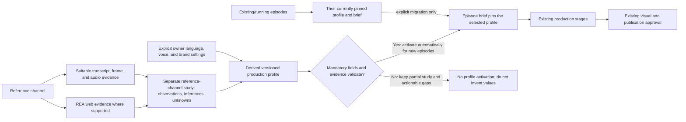

# Architecture Renewal Audit and Migration Plan

Status: REVIEWABLE. The architecture interview is settled through Q23. This is an audit and migration plan; implementation, cleanup, installation, and provider actions remain pending separate scoped authorization and evidence.

Task ID: architecture-audit-plan

Prepared: 2026-10-23

Decision record: [Architecture renewal interview](./architecture-renewal-interview.md)
Domain language: [GLOSSARY.md](../../GLOSSARY.md)

## Purpose and success measures

Reduce regressions, make module and document ownership easier to find, and shorten diagnosis when a feature changes. Keep the current Python architecture and improve its boundaries incrementally. A stack change or rewrite requires evidence that a named subsystem is uneconomic to repair.

This is the first reviewable audit and migration plan. It deliberately stops before cleanup, code changes, skill removal, document moves, runtime pruning, provider runs, or a Channel DNA implementation.

Measure the outcome in later batches: time from task start to correct owner and check discovery; regression count and severity after scoped changes; time from failure report to a reproduced root cause; and count of changed files outside the owning domain. Baselines are not yet measured, so no improvement claim is made.

## Decisions currently recorded

- Safer and faster feature changes are the primary goal.
- Repair incrementally; retain the current Python architecture and improve module boundaries.
- A monorepo or Turborepo is considered only if independently built applications or packages emerge.
- Consolidate guidance and document ownership first, then use a bounded Channel DNA workflow to improve boundaries.
- The first deliverable is an audit and migration plan, not cleanup implementation.
- New channel profiles are intended for new episodes; existing and running episodes remain pinned unless explicitly migrated.
- Inferred traits may be applied automatically. This does not remove existing episode preview, visual acceptance, provider authorization, or publication gates.
- Use proportional research and delegation based on uncertainty, risk, cost, and expected value while retaining required research, ownership, verification, and authorization controls.
- Map stage-contract checklists to existing jobs, recipes, checkpoints, and publication controls; introduce abstractions only for demonstrated gaps.
- Channel DNA includes script structure, pacing, visual composition and motion, audio treatment, titles, and thumbnails, with traits tied to examples/timestamps and uncertainty recorded.
- Keep reference-channel study separate from target production identity; use owner language, voice, and brand constraints as overrides to inference.
- Use evidence appropriate to each modality and record unsupported traits as unknown.
- Target local Windows production with one operator managing channels; hosted multi-user operation is out of scope.
- REA role is settled by Q22: use it as a named evidence-collection adapter where documented capabilities fit. Initial primary-source research is complete; Windows/runtime feasibility and the usefulness of collected evidence remain bounded pilot proofs. No installed dependency/release has been selected.

- REA adapter (Q22): use the named REA tool as a capability-matched evidence collector; keep transcript, video/frame, audio, and semantic interpretation in separate components where needed. Python remains the application stack; Node may be an optional tool runtime. Initial primary-source research is complete; future proof covers Windows/runtime feasibility and actual evidence value.
- New-profile activation (Q23): activate automatically for new episodes only when concrete mandatory fields and their evidence validate, preserving owner settings. Unknown optional traits remain unknown; missing mandatory evidence leaves a partial study and actionable gaps. No routine profile-approval gate; active episodes remain pinned absent explicit migration.

## External proposal disposition

Archived source report: [assessment report](../../.runtime/architecture_renewal_audit_20261023/PROJECT_MODERNIZATION_ASSESSMENT_REPORT_2026-10-23.md.bin), SHA-256 7369e08a2b8f5057274578d43092743be2ad7d0439a1bb5793af3ba6946ae3b4. [Playbook](../../.runtime/architecture_renewal_audit_20261023/PROJECT_MODERNIZATION_PLAYBOOK_2026-10-23.md.bin), SHA-256 1e72f8b517a64b23d58f3ae8bd75e5182a6478d47b0639125b2ecd8060fe7407. These evidence files remain unchanged.

- Accepted: incremental modular Python, existing domain ownership, classify-before-prune, a bounded Channel DNA pilot, one operator/local workflow, preserve data and resumability.
- Modified: treat M01–M16 as a reference menu, not 16 mandatory phases. Reuse the existing task/HANDOFF owner instead of adding parallel status registers. Map stage checklists to current durable jobs, recipes, checkpoints, and publication controls; add abstractions only for proven gaps. Keep error records minimal, with richer metadata optional; create local manifests only where rules differ.
- Deferred: cleanup, retention/deletion actions, new packages or stack, provider actions, and any migration implementation until a named batch has evidence, acceptance checks, and rollback.
- Navigation naming remains open: proposed docs/README.md here versus docs/index.md in the playbook. Choose one before creating it. A separate docs/architecture.md is optional only if it uniquely owns component/data-flow reference material extracted from existing guidance.
- Snapshot mismatch: the proposals describe a feature branch at HEAD 738ee77; current repository state is master at c774383. Their test counts are historical, not current validation. Do not reopen repaired packaging or quota-recovery findings without new evidence.

## Audit method and evidence boundary

Inventory snapshot note (2026-10-23): root AGENTS.md was 36,101 bytes in the initial INVENTORY.json snapshot and 36,465 bytes after the coordinator added the renewal-preference pointer and glossary ownership. Later guidance edits and a journal-recovery refactor are recorded in the current HANDOFF; these audit findings remain dated observations, not a claim that later work is unimplemented. Reconcile each batch with current source before execution. Keep INVENTORY.json unchanged as historical evidence.

Facts below combine bounded repository inspection and coordinator/explorer readback. The exact inventory receipt is [INVENTORY.json](../../.runtime/architecture_renewal_audit_20261023/INVENTORY.json). Its initial snapshot recorded 74 source Python files and 167 Markdown files; the new plan adds one Markdown file. The runtime directory count is an entry count, not a recursive byte or last-used census.

Read current contracts before modifying a domain: root [AGENTS.md](../../AGENTS.md), [GEMINI.md](../../GEMINI.md), platform [CLAUDE.md](../../CLAUDE.md), and the nearest scoped instructions. Current GEMINI guidance governs where older AGENTS text differs. This plan does not reverse that precedence.

Existing scoped contracts include [production/AGENTS.md](../../src/youtube_automation/production/AGENTS.md), [channels/AGENTS.md](../../channels/AGENTS.md), [tools/AGENTS.md](../../tools/AGENTS.md), [tests/AGENTS.md](../../tests/AGENTS.md), and [docs/agents/AGENTS.md](../agents/AGENTS.md). Do not duplicate their detailed production, channel, utility, fixture, or skill-config rules in a new root guide.

The evidence snapshot counted 166 Markdown documents before the interview, 167 after it, and 168 after this plan. It counted 17 direct documentation subfolders. These counts describe the snapshot boundary; they do not establish freshness, correctness, or whether a file is unused.

## Findings

### P0 — conflicting operator instructions

The current CLAUDE.md says to clear Audacity SessionData/AutoSave, while root AGENTS requires preserving recovery data and prohibits automatic clearing. Treat the destructive instruction as blocked pending reconciliation.

CLAUDE.md describes terminating a process by listening port. Root guidance requires proving exact process identity, creation time, profile, listener, and lease ownership. A port match alone is insufficient authority to terminate a process.

CLAUDE.md describes newline framing that conflicts with the root Windows Audacity contract: command plus CRLF plus NUL. Keep platform framing in one authoritative contract and make any adapter match the verified implementation.

These are instruction conflicts with potential data loss or process interference, not proof that current code performs the unsafe actions. Inspect callers and checks before changing instructions.

### P1 — conflicting quality and language authority

CLAUDE.md says to run mypy with ignore-missing-imports; root guidance defines the full gate as mypy --strict src/. Reconcile the command and CI contract while preserving discovery and checking scope.

CLAUDE.md describes CONTEXT.md as a full glossary. The current docs/agents/domain.md points to root GLOSSARY.md for shared domain vocabulary and keeps existing CONTEXT.md vocabulary during transition. Preserve both vocabularies until consumer checks and term-by-term migration are complete.

The root GEMINI frontmatter last_indexed value is 2026-09-09. This is a stale freshness marker, not evidence that every instruction is wrong. Compare individual claims to code, tests, ADRs, and active workflows.

### P1 — instruction-loading ceiling risk

The official [AGENTS.md configuration guide](https://learn.chatgpt.com/docs/agent-configuration/agents-md) documents a 32 KiB default maximum for the combined instruction chain. The initial inventory snapshot recorded root AGENTS.md at 36,101 bytes; its size at the 2026-10-23 audit closeout was 36,465 bytes. Exact-key searches of the global and repository Codex config files found no project_doc_max_bytes override. Effective settings, CLI flags, and app-injected instructions remain unverified; this is a loading risk, not proof that this conversation omitted instructions. Trim the shared root contract and validate discovery with a fresh supported agent before claiming a fix. Do not change global configuration for this audit.

### P2 — product and architecture documentation drift

The existing [product overview](./product.md) is 32 lines and mixes product claims with a historical completed-run/phase description. Current GEMINI guidance describes an opt-in adaptive channel workflow. Reconcile and label the existing file; do not create another root PRODUCT.md.

Five ADRs exist under [docs/adr](../adr/0001-timeline-unification.md). Use them as the decision record and identify which decisions still govern current code before drafting any new ADR.

README.md covers legacy and adaptive paths. Their coexistence is not evidence of dead code. Label supported, legacy, and historical paths using current entrypoints and tests before proposing removal.

### P2 — instructions are large and unevenly scoped

Initial inventory snapshot sizes: root AGENTS.md 36,101 bytes, GEMINI.md 47,171 bytes, and CLAUDE.md 16,983 bytes. Root AGENTS.md was 36,465 bytes at the 2026-10-23 audit closeout, as noted above. Size alone is not the cause; contradictory, duplicated, stale, and hard-to-route rules are the actionable defects.

There are 74 Python modules under src, 28 root Python facades/CLIs, and 50 Python tools. The project is Python/setuptools (minimum Python 3.10), with existing domain packages. The inventory found no application JavaScript or Turborepo build configuration. These facts do not support adopting Turborepo now.

Root facades preserve legacy CLI calls and dynamic monkeypatch behavior. Prompt assets and channel JSON are packaged/release inputs. Preserve these compatibility contracts during any future moves.

### P2 — error records need retrieval structure

[understood-errors.md](../error-solving/understood-errors.md) is 335 split lines and 63,366 bytes, with 66 level-three case headings and 71 total headings. It has no local AGENTS contract. The file is large enough to need an index and individual cases, but count and length alone do not prove that every record should move.

Some entries encode distinct constraints, such as QSV lookahead and pixel format. Do not merge cases by keyword or create folders by file format. Keep raw evidence and old anchors resolvable during a staged migration.

A model-selector soft-failure record is a candidate for review because it may lack freshness/scope details. Do not label its fix incorrect until callers and current tests are checked.

### P2 — skill directories need provenance and binding checks

The lock records 109 active skills, 21 archived entries, 24 bound skills, 52 task bindings, and 333 archive files. A bounded independent check verified 109 active and 333 archive file hashes. The 85 active but unbound skills are candidates for review, not proven dead.

The project has 110 directories under .agents/skills. .claude/skills has 14 physical directories, 12 names, and SKILL.md copies matching .agents. A separate unlisted agent-automation-skill directory exists. Inspect bindings, provenance, dependencies, and platform discovery before consolidating copies.

.codex/config.toml records that prior Codex 0.160 did not enforce project skill selection. That is a historical configuration claim; verify current discovery behavior and fresh-chat catalog before changing configuration. Do not add a toggle controller or alter global user settings.

### P2 — .runtime is referenced operational state

HANDOFF and skill-installation receipts refer to release, merge, setup, and archive evidence in .runtime. The audit snapshot counted 352 top-level entries including its own audit folder (351 before it), but has no recursive size or last-use census.

Ignored status does not mean disposable. Preserve release and merge receipts, preimages, rejected evidence, active checkpoints, leases, profiles, and resumable state. Do not apply a blanket age-based deletion rule. No .runtime deletion candidate is authorized.

### P3 — code size guides inspection only

- Largest measured source modules include src/youtube_automation/production/shots.py (4,173 lines), src/youtube_automation/audio/tts_generator.py (3,847), src/youtube_automation/visuals/flow_generator.py (2,725), src/youtube_automation/video/compiler.py (2,363), and src/youtube_automation/production/briefs.py (1,519). These sizes prioritize change-coupling review; they do not establish poor design or justify splitting files without a concrete seam and caller evidence.

## Target documentation and instruction model

Keep one shared root AGENTS contract for repository policy, source-of-truth routing, DOX, and verification. Keep GEMINI.md and CLAUDE.md as concise platform adapters. Do not duplicate the same imperative rule across these files.

Keep local domain contracts beside stable ownership boundaries. Existing production, channels, tools, tests, docs/agents and skill archive contracts are the starting map. Add a local manifest only when a real domain boundary has distinct ownership, work guidance, verification, and child index.

Add one navigation map after settling its filename: docs/README.md is the current candidate; the external playbook suggests docs/index.md. Map each maintained document to owner, audience, current/historical/superseded/unknown status, and canonical replacement. Avoid empty Diátaxis folders and duplicate root PRODUCT.md, DESIGN.md, or indexes. A separate docs/architecture.md is optional only if it uniquely owns a component/data-flow reference extracted from current guidance.

Retain the managed Pane block in AGENTS.md unchanged absent specific authorization. Keep HANDOFF compact session state; keep durable contracts in their owning AGENTS. The coordinator owns shared HANDOFF and root contract edits.

## Target error-record model

Proposed ownership: docs/error-solving/AGENTS.md, docs/error-solving/README.md, a case template, and shallow case groups only when real retrieval or rule differences justify them. These paths are proposed, not created.

Keep the minimum record small: stable case ID/title, affected scope/version, symptom, disposition/status, one or more evidence references, verified cause/fix, prevention rule, and a check. Keep timestamps, environment detail, related cases, confidence, supersession history, and reproduction metadata when useful; richer fields are optional.

Preserve exact raw receipts and preimages separately from concise cases. Keep old IDs and anchors resolvable; use a current disposition index to distinguish active, corrected, superseded, and unverified claims.

Use a shallow domain manifest only when that domain has rules or checks different from its parent. Do not build a deep taxonomy by file extension/output format or merge distinct failures by keyword. Review the model-selector soft-failure case against callers and tests before classifying it.

## Target Channel DNA boundary

Keep the workflow inside the existing production domain until evidence proves a new module boundary is needed. Current Channel and Brief contracts already bind channel inputs; compile_episode_visual_strategy in production/briefs.py:250–290 creates episode direction without changing channel identity.

ensure_brief in production/briefs.py:293–366 snapshots the profile hash, compares a supplied channel fingerprint, and rejects changed inputs when downstream artifacts exist. contracts.py:217–238 carries channel and profile_sha256. Preserve these stale-input protections and explicit migration boundary.

Channel.version values 1–3 are schema versions, not immutable profile revision history. Do not infer profile lineage from this field. Define profile revision identity separately only after checking persisted formats and migration behavior.

Keep the reference-channel study separate from the target production profile. The study should record observed facts and inferred traits with modality-appropriate evidence, example/timestamp support, and uncertainty; mark unsupported traits unknown. Owner language, voice, and brand constraints take precedence over inference.

The bounded profile should cover script structure, pacing, visual composition and motion, audio treatment, titles, and thumbnails. Use the user-required REA only after read-only research proves what role it can safely play. Its official repository overview describes app, website, and binary analysis; it does not establish a YouTube-channel video-analysis capability. Do not install or run it as part of this plan.

Apply a validated target profile automatically to new episodes. Keep existing/running episodes pinned unless explicitly migrated. Preserve owner constraints, saved voice policy, current preview/shot review, visual acceptance, provider authorization, and publication gates. Profile inference is not approval of output or release.

Map any stage-contract checklist onto existing durable jobs, recipes, checkpoints, invalidation, and publication controls before adding a new abstraction. Add only a concrete contract needed to close a demonstrated gap.

## Migration batches and gates

### Batch 0 — complete the audit and plan

Status: Complete for this deliverable. Q1–Q23 are settled, the external proposals have been reviewed, and initial primary-source REA research is recorded. This audit plan is reviewable; no user answers remain for this phase. Windows/runtime feasibility and actual evidence value are future Batch 5 proof prerequisites. This batch did not install REA, run a provider/browser workflow, or implement project changes.

### Batch 1 — reconcile urgent instructions and document routing

Owner: coordinator for AGENTS/HANDOFF; documentation executor for owned platform/domain docs. Resolve P0 destructive/process conflicts first, then typing and glossary authority. During migration, preserve current effective authority while shared rules and scoped routes are being reconciled. After every shared rule and route is migrated and verified, make one atomic bounded documentation switch to shared AGENTS.md authority; GEMINI.md and CLAUDE.md become platform adapters that route to it. Remove/replace both old AGENTS-to-GEMINI override statements and any reciprocal stale precedence clauses together, then verify there is no circular or competing authority and all existing guards remain intact. This plan edit does not perform that switch.

Create the proposed docs/README.md navigation map only after inventorying existing docs and ADR owners. Reconcile product.md in place; map superseded material rather than copying it into another root file. Keep root policy concise and platform adapters specific.

Acceptance: no contradictory operator instruction remains for recovery-data deletion, process ownership, Windows pipe framing, typing gates, or glossary authority; all legacy precedence clauses are removed/replaced in the same verified switch; no authority cycle remains; every navigation entry has a verified target and owner; managed Pane text remains unchanged; links and old anchors are checked.

Rollback: revert only the batch's bounded documentation edits from captured byte preimages. Keep historical records and do not normalize mixed line endings.

### Batch 2 — structure the error register without losing evidence

Owner: error-solving documentation maintainer. Inventory case IDs, incoming links, evidence receipts, duplicates, statuses, and exact source bytes before moving records.

Create the shallow index/template and migrate a small representative set first, including distinct failure layers. Preserve original IDs and raw evidence; add old-to-new links and a disposition record. Review the soft-failure example against actual callers and tests.

Acceptance: all prior anchors resolve or redirect; every migrated case has required evidence/status/check fields; no evidence is rewritten or discarded; a fresh lexical lookup can find a case by ID, symptom, layer, and prevention check.

Rollback: restore the captured original register bytes and remove only newly created indexes/cases from this batch. Keep the archive and migration map.

### Batch 3 — verify skill discovery and consolidate safely

Owner: skill configuration maintainer. Verify active platform/version discovery, project lock semantics, fresh-chat behavior, task bindings, sources, and dependencies before classifying copies.

Classify each entry as canonical active, bound, archive, duplicate, or unresolved. Preserve .agents/skill-archive receipts and hashes. Do not delete a directory solely because it is unbound, duplicated, old, or absent from one platform catalog.

Acceptance: every active task binding resolves to a verified source; every archive mapping and hash verifies; each proposed removal has no active binding/dependency and a recoverable source; global settings remain untouched.

Rollback: restore only from verified archive copies and retain the prior lock/config snapshot.

### Batch 4 — inventory runtime and legacy candidates

Owner: runtime/artifact maintainer. Build a path-level inventory with owner, class, bytes/hash, reference scan, live-use evidence, resumability, restore method, and retention rule.

Keep release/merge receipts, preimages, rejected evidence, active checkpoints, leases, and profiles. Separate active state, referenced evidence, cache, and unknown items. A low static-reference count is not deletion proof; inspect dynamic paths and recovery consumers.

Audit root facades, packaged prompt mirrors, channel JSON, and legacy entrypoints against release workflow and tests. Migrate useful maintenance scripts only with inert-import behavior, explicit execution, compatibility, and offline checks.

Acceptance: every candidate has a verified owner and reference result; unknowns remain preserved; restore is demonstrated for anything archived; no time-based policy expires evidence or resumable state automatically.

Rollback: restore only exact archived bytes by hash and reinstate the prior activation/config pointer. Preserve the receipt explaining the disposition.

### Conceptual channel-study and production flow

This target flow does not claim an REA integration or media-analysis component exists. REA is an evidence adapter only where its documented capabilities fit; modality-specific analysis and Windows feasibility remain to be proven.

### Batch 5 — implement one Channel DNA vertical slice after prerequisites
Prerequisites (not silently selected by this audit): choose a bounded sample count and source-video eligibility rule; specify mandatory profile fields, evidence bindings, and activation validation; prove the selected REA/runtime path on the target Windows setup and measure actual evidence value; identify real local channel/video inputs and separately authorized access/provider grants; define focused checks for channel isolation, partial-study recovery, owner-setting precedence, and new-episode activation while existing episodes remain pinned. Until resolved, this batch is a design target, not executable authorization.

Owner: production-domain executor, with independent tests and review. Keep work within existing production contracts and brief compilation until evidence proves a new module boundary is needed.

Specify bounded source selection, evidence provenance, profile validation, explicit profile revision identity, automatic use for new episodes, and pinned existing/running episodes. Make explicit migration a separate operation with bound inputs and invalidation checks.

Acceptance covers two-channel isolation; bounded video selection; evidence/inference/preference separation; save, resume, and profile-edit behavior; malformed or conflicting inference; unchanged existing-episode identity; explicit migration; stale downstream artifact rejection; and no duplicate channel/episode policy.

Preserve tests in test_production_briefs.py for profile writing, rebind identity, voice, and checkpoint behavior. Add focused coverage in the existing owner before the frozen full suite. No provider reverse-engineering run is part of this planning batch.

Rollback: preserve the prior profile and brief bytes, keep prior accepted assets/reports immutable, invalidate only the new attempt lineage, and verify the active episode still binds its pinned profile hash.

## Verification strategy

For a future behavior batch, first run focused tests once: python -m pytest -q --tb=short -x followed by the named files owned by the change. For Channel DNA, include tests/unit/test_production_briefs.py and relevant asset/manifest/replay tests.

Before a frozen full-tree closeout, run repository-required tests, ruff, mypy --strict src/, build/package checks, and the adaptive failure replay corpus once against the exact tree. Do not treat the narrower CI tests/unit command as proof of the full root contract.

For docs-only batches, verify changed links, old-anchor routing, ownership indexes, exact changed-path scope, and whitespace. tools/lint_exercises.py validates exercise links only; no general Markdown/link gate was found.

No tests, build, QMD reindex, provider action, Git mutation, or destructive operation was run for this plan.

## Stop conditions and unresolved audit evidence

Stop a cleanup candidate if its owner, active consumer, provenance, or restore path is unknown. Preserve it and mark the missing evidence.

Stop a code-boundary move if callers, package resources, CLI behavior, monkeypatch compatibility, or release contents are not mapped. Do not create packages to make the tree look modular.

The interview is settled through Q23 and this plan is reviewable. No further user answers are outstanding for this phase. Resolve the bounded Batch 5 prerequisites before pilot implementation; this plan itself does not authorize implementation.

## Research receipt — 2026-10-23 UTC
- REA reviewed read-only: [project README](https://github.com/morluto/rea/blob/main/README.md), [package metadata](https://github.com/morluto/rea/blob/main/package.json), and [browser observation docs](https://github.com/morluto/rea/blob/main/docs/browser-observation.md). Release metadata reports rea-agents 6.7.0 and Node ^22.19.0 || ^24.11.0 || >=26.0.0. Browser observation describes passive CDP evidence capture (DOM, scripts, network, screenshots); it does not establish a built-in semantic analyzer for channel videos. Local node/npm are present and rea was not found on PATH; this is not proof that REA is absent elsewhere. No installed dependency/release has been selected and no installation or live run occurred. Windows/runtime feasibility and evidence value remain future bounded proofs. Detailed excerpts and pinned source blob SHAs: [REA_RESEARCH.json](../../.runtime/architecture_renewal_audit_20261023/REA_RESEARCH.json).

- [OpenAI official AGENTS.md configuration guide](https://learn.chatgpt.com/docs/agent-configuration/agents-md), checked 2026-10-23 UTC: combined instruction-chain limit defaults to 32 KiB. Root AGENTS.md alone is larger; actual effective discovery/loading remains unverified, so record a risk rather than asserting truncation.

REA official read-only source: [morluto/rea](https://github.com/morluto/rea). It describes app, website, and binary reverse-engineering through MCP and CLI; no channel-video capability was established. No REA version is pinned or installed.

## Evidence references

- [Root policy](../../AGENTS.md), [current project guidance](../../GEMINI.md), [platform guidance](../../CLAUDE.md)
- [Existing product overview](./product.md), [ADR 0001](../adr/0001-timeline-unification.md), [ADR 0002](../adr/0002-encoding-ladder.md), [ADR 0003](../adr/0003-prompt-extraction.md), [ADR 0004](../adr/0004-text-collision-gate.md), [ADR 0005](../adr/0005-audio-dsp-contract.md)
- [Domain terminology and documentation consumers](../agents/domain.md), [production contract](../../src/youtube_automation/production/AGENTS.md), [channel contract](../../channels/AGENTS.md), [tool contract](../../tools/AGENTS.md), [test contract](../../tests/AGENTS.md)
- [Error register](../error-solving/understood-errors.md), [inventory receipt](../../.runtime/architecture_renewal_audit_20261023/INVENTORY.json)
- [Channel contract source](../../src/youtube_automation/production/contracts.py), [brief compiler source](../../src/youtube_automation/production/briefs.py), [brief regression tests](../../tests/unit/test_production_briefs.py)
- [Archived modernization assessment](../../.runtime/architecture_renewal_audit_20261023/PROJECT_MODERNIZATION_ASSESSMENT_REPORT_2026-10-23.md.bin), [archived playbook](../../.runtime/architecture_renewal_audit_20261023/PROJECT_MODERNIZATION_PLAYBOOK_2026-10-23.md.bin)
- [Interview record](./architecture-renewal-interview.md), [REA repository](https://github.com/morluto/rea)
- Related checks: test_prompt_package_resources.py, test_prompt_loader.py, test_prompt_contracts.py, test_pipeline_manifest.py, test_production_assets.py, and test_semantic_failure_replay.py under tests/unit.
